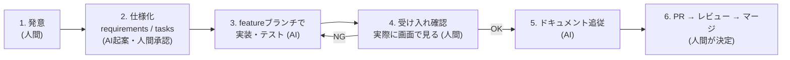

# 開発の進め方

このプロジェクトの開発プロセスの定義。**SDD(仕様駆動開発)+ AI駆動開発**を基本とする。

- **仕様([docs/](docs/))が常に正であり、コードはそれに追従する。**
  コードと仕様のズレは、「画面の絵と書き出したコードのズレ」と同種の欠陥として扱う。
- **実装の大部分は AI(Claude Code 等)が行い、人間は「何を作るか」と「受け入れ」に集中する。**

## 役割分担

| 責務 | 人間(指示者) | AI(実装者) |
| --- | --- | --- |
| 何を作るかの決定・優先度付け | **決定** | 提案まで |
| 仕様文書(requirements / tasks)の更新 | 承認 | 起案・記述 |
| 設計・実装・テスト | — | **実施** |
| 動作の受け入れ確認(実際に画面を触る) | **実施** | 起動・自動確認まで |
| PR レビュー・マージ | **決定** | セルフレビュー(/code-review 等)まで |

権限の線引き: **main へ直接 push しない(人間も AI も)。**
すべての変更は feature ブランチ → PR → マージで入る。

## ドキュメントと所有権

| 文書 | 内容 | 主な書き手 | 更新タイミング |
| --- | --- | --- | --- |
| [docs/vision.md](docs/vision.md) | なぜ作るか(原則・非目標) | 人間 | 方針が変わるときだけ |
| [docs/requirements.md](docs/requirements.md) | 何を作るか(要求一覧) | AI が起案、人間が承認 | 機能の追加・完了ごと |
| [docs/design.md](docs/design.md) | どう作っているか(設計) | AI | 実装と同じ PR で |
| [docs/tasks.md](docs/tasks.md) | 次に何をやるか | AI が分解、人間が優先度 | 着手前・完了後 |

仕様は機能ごと・issue ごとに文書を作る方式(使い捨てスペック)ではなく、
**プロジェクトで1組だけの生きた文書を更新し続ける**方式を取る。
常に「現在の目標状態」を表すのがこの4枚であり、
個々の作業で何をどう変えたかは PR の diff が記録する。

機能を入れる PR には、対応するドキュメント更新(requirements のトレース表、
design.md、README、tasks.md)を**必ず同じ PR に含める**。

## エンハンスの標準フロー

1. **発意(人間)** — やりたいことを自然言語で伝える。
   - いま着手する → 会話でそのまま指示すればよい
   - いまは着手しない → [tasks.md](docs/tasks.md) に積む(**バックログは issue ではなくここ**)
   - GitHub issue は**宿題帳**として使う: 開発セッションの終わりに、
     次回以降にやるべき積み残し・セッション中に見つけた課題を issue に書き留めて終える。
     ほか、セッション外で思いついたことの受け皿・他メンバーからの報告窓口も兼ねる。
     着手時に tasks.md へ取り込み、対応する PR の `Closes #N` で閉じる
2. **仕様化(AI 起案 → 人間承認)** — 作り始める前に
   [requirements.md](docs/requirements.md) / [tasks.md](docs/tasks.md) へ反映する。
   [vision.md](docs/vision.md) の方針と矛盾する要望には AI が指摘を返す。
   誤字修正などの軽微な変更は省略してよい。
3. **ブランチ(AI)** — `feature/YYYYMMDD_<主題>` を main から切る。
4. **実装(AI)** — 実装・テストし、アプリを起動して動作確認できる状態まで持っていく。
5. **受け入れ(人間)** — 実際に画面を触って確認する。NG なら 4 に戻る。
6. **ドキュメント追従(AI)** — トレース表の状況、design.md、README、tasks.md を更新。
7. **PR(AI が作成、人間がマージ)** — issue があれば本文に `Closes #N`。
   レビューは人間の目視 + AI レビュー(/code-review 等)を併用する。

## コミュニケーションの原則

- 人間は**目的**を伝える(「〜できるようにしたい」)。実装手段は AI が提案する。
- AI は、答えが分かれる判断(UX・優先度・破壊的変更)を勝手に決めず人間に確認する。
  技術的な定石で決まることは確認せず進めてよい。
- 会話で決めた事柄のうち後で効くもの(方針・規約)は文書に落とす。
  **会話ログは仕様ではない。**

## 規約

- **ブランチ名**: `feature/YYYYMMDD_<主題>`(例: `feature/20260809_geocode-search`)
- **コミットメッセージ**: 英語・命令形の要約1行 + 必要なら本文(既存の履歴に倣う)
- **PR 本文**: 何を・なぜ・確認方法。関連 issue があれば `Closes #N`
- **AI への常設指示**: [CLAUDE.md](CLAUDE.md)(Claude Code が毎セッション自動で読む)
