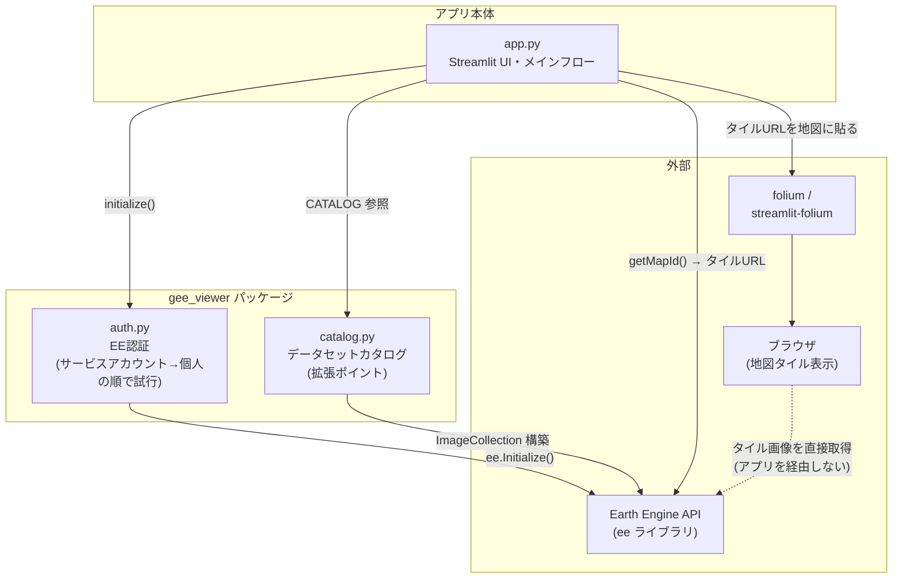
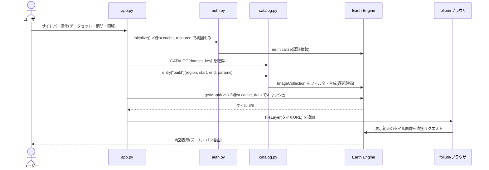
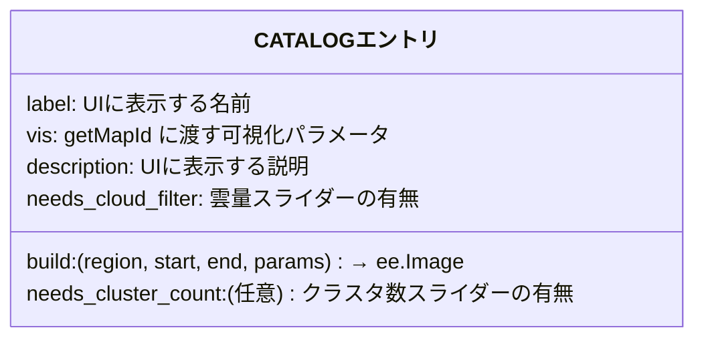

# アーキテクチャ

現状のプログラム構成の設計書。図は Mermaid で記述しており、GitHub 上でそのまま描画される。

## モジュール構成

全体で約300行・3モジュール。クラスは使わず、関数と辞書で構成されている。

### 各モジュールの責務

| モジュール | 責務 |
| --- | --- |
| [app.py](../app.py) | Streamlit の UI(サイドバー入力)、EE 初期化の呼び出し、タイルURL取得、folium 地図の描画。状態を持たず、入力が変わるたびに上から再実行される(Streamlit の実行モデル) |
| [gee_viewer/auth.py](../gee_viewer/auth.py) | EE 認証。サービスアカウント(Streamlit secrets → 環境変数の順)を探し、なければ個人認証にフォールバック。将来の一般公開時もコード変更不要 |
| [gee_viewer/catalog.py](../gee_viewer/catalog.py) | データセット定義の集約。`CATALOG` 辞書がアプリ唯一の拡張ポイント |

## 処理フロー

ユーザーがサイドバーを操作するたびに Streamlit がスクリプト全体を再実行する。
重い処理は 2 つのキャッシュで 1 回だけ実行される。

設計上のポイント:

- **ピクセルを一切ダウンロードしない。** `getMapId()` のタイルURLを folium に渡すだけなので、
  転送量はほぼゼロで、ズーム・パンはブラウザと EE 間で完結する。
- **キャッシュの二層構造。** EE 初期化は `@st.cache_resource`(プロセスで1回)、
  タイルURL取得は `@st.cache_data`(入力パラメータの組が同じなら再利用)。

## 拡張ポイント: CATALOG エントリ

新しいデータセット・可視化の追加は `catalog.py` への追記だけで完結し、`app.py` の変更は不要。

現在の登録済みエントリ(8件):

| キー | 内容 | ソース |
| --- | --- | --- |
| `s2_true_color` | トゥルーカラー(B4/B3/B2 中央値合成) | Sentinel-2 |
| `s2_false_color` | フォールスカラー(NIR/Red/Green) | Sentinel-2 |
| `s2_ndwi` | 水域指数 NDWI | Sentinel-2 |
| `s2_ndvi` | 植生指数 NDVI | Sentinel-2 |
| `s1_vv` | SAR 後方散乱(VV・下降軌道・平均) | Sentinel-1 |
| `dem` | 標高(30m 全球 DEM、期間指定は無視) | Copernicus DEM |
| `s2_kmeans` | k-means 教師なし分類(学習・分類とも EE サーバー側) | Sentinel-2 |
| `s2_coastline` | 海岸線抽出(NDWI 2値化 + Canny 法、重ね合わせ用) | Sentinel-2 |

Sentinel-2 系 4 件は共通の `_s2_collection()`(領域・期間・雲量フィルタ)を土台にしている。
