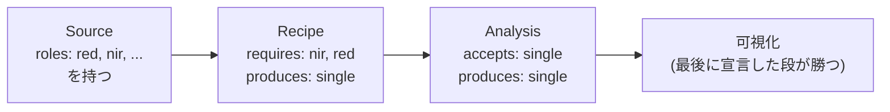
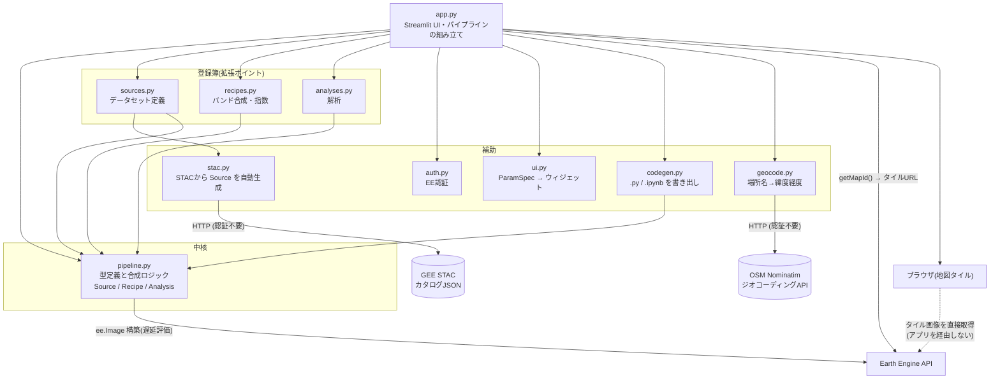
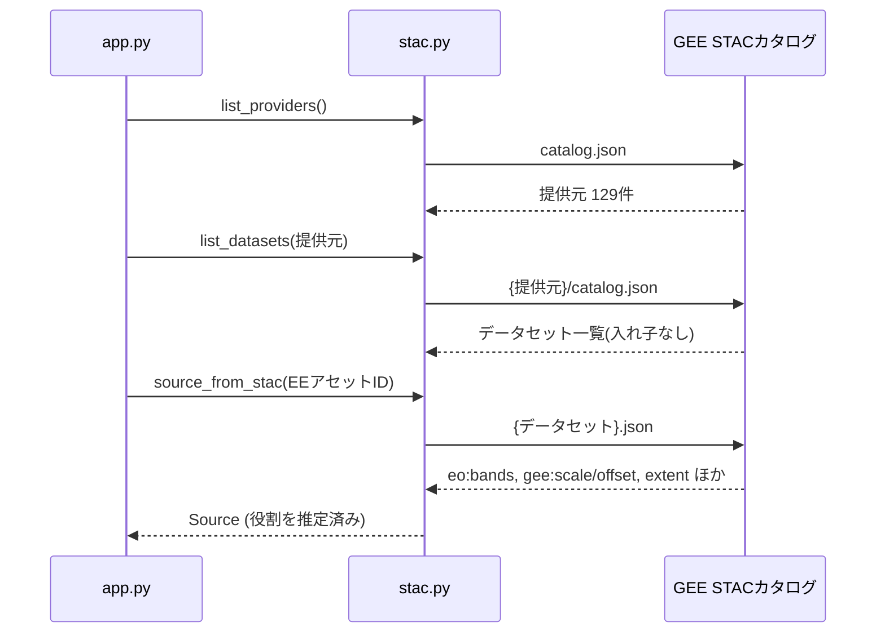
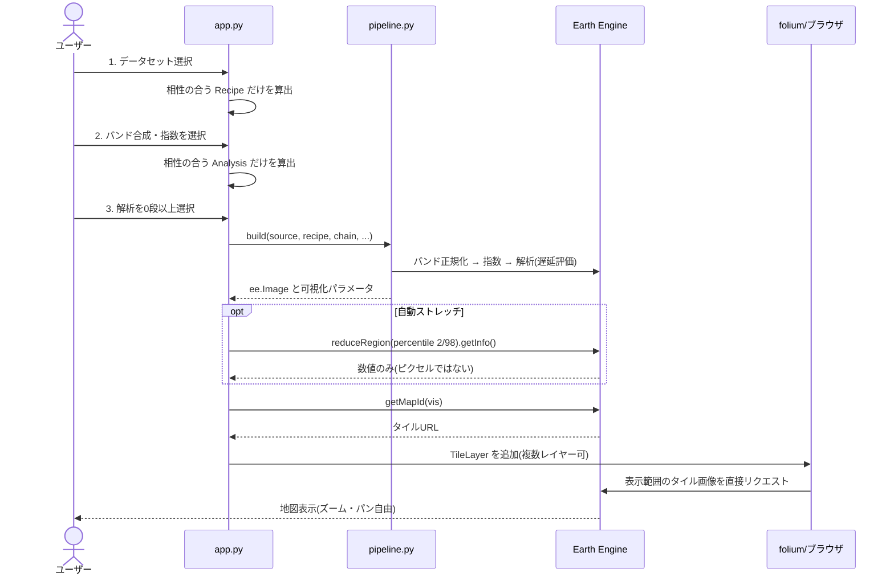
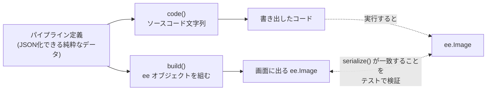
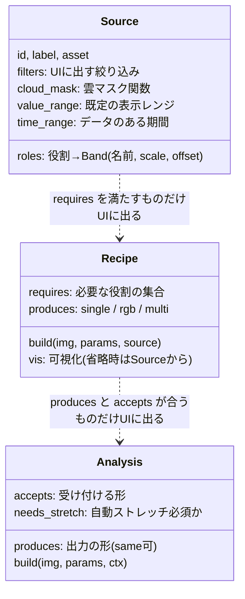

# アーキテクチャ

現状のプログラム構成の設計書。図は Mermaid で記述しており、GitHub 上でそのまま描画される。

このドキュメントは「どう作っているか」を扱う。
**「なぜ作るのか」「何を目指すのか」は [vision.md](vision.md)、
「何を作るか(要求一覧)」は [requirements.md](requirements.md) を参照。**
以下の設計判断はすべて、vision.md に書かれた目的から導かれている
(対応表は末尾の[「設計判断まとめ」](#設計判断まとめ目的との対応))。

## 基本の考え方: 直積を列挙せず、合成する

このアプリの中心はドリルダウン型のパイプラインである。

```text
データセット → バンド合成・指数 → 解析(0段以上) → 可視化
   Source          Recipe          Analysis         vis
```

以前は「Sentinel-2 の NDWI」「Sentinel-2 の NDWI + Canny」のように、
**3つの軸の直積を1件ずつ手で列挙**していた。これは軸が増えると破綻する
(衛星10 × 合成6 × 解析4 = 240件を手書きすることになる)。

現在は各軸を独立した登録簿に分け、実行時に合成する。衛星を1つ足せば
既存の全指数・全解析がその衛星でも使えるようになる、という加算的な構造。

各段は「何を要求し、何を出すか」を宣言する。UI はその宣言を見て、
**上流と相性が合う選択肢だけ**を次の段に出す。



Sentinel-1 は `red` も `nir` も持たないので、トゥルーカラーも NDVI も
選択肢に現れない。Canny は `accepts: single` なので、トゥルーカラー
(rgb)の直後には出てこない。この整合性は宣言から自動的に決まり、
UI 側に個別の条件分岐は存在しない。

## モジュール構成

全体で約1,800行。クラスは型定義(dataclass)にのみ使い、処理は関数で構成する。



| モジュール | 責務 |
| --- | --- |
| [app.py](../app.py) | サイドバーのドリルダウン、パイプラインの組み立て、タイルURL取得、folium 地図の描画、レイヤーの重ね合わせ管理 |
| [pipeline.py](../gee_viewer/pipeline.py) | `Source` / `Recipe` / `Analysis` / `ParamSpec` の型定義と、それらを1枚の `ee.Image` に解決する `build()`。相性判定もここ |
| [sources.py](../gee_viewer/sources.py) | よく使うデータセット17件の定義(役割マップ・雲マスク・フィルタ) |
| [recipes.py](../gee_viewer/recipes.py) | バンド合成・指数19件。役割名だけで書かれており衛星に依存しない |
| [analyses.py](../gee_viewer/analyses.py) | 解析12件。すべて EE サーバー側演算 |
| [stac.py](../gee_viewer/stac.py) | GEE の STAC カタログから任意データセットの `Source` を自動生成 |
| [codegen.py](../gee_viewer/codegen.py) | パイプライン定義から実行可能な `.py` / `.ipynb` を生成 |
| [ui.py](../gee_viewer/ui.py) | `ParamSpec` から Streamlit ウィジェットを生成 |
| [auth.py](../gee_viewer/auth.py) | EE 認証。サービスアカウント → 個人認証のフォールバック。個人認証のプロジェクトIDは環境変数 `EE_PROJECT`(既定値なし。未設定は `ProjectNotSetError`)。プロジェクト直下の `.env` は自前の最小パーサで読む(追加パッケージなし、設定済みの環境変数を優先) |
| [geocode.py](../gee_viewer/geocode.py) | 場所名から緯度経度への変換(OSM Nominatim)。サイドバーの場所検索の裏側 |

## 要: バンドの「役割」への正規化

衛星ごとにバンド名も格納値のスケールも違う。これを `Source` の段で吸収する。

| | 赤 | 近赤外 | 反射率への変換 |
| --- | --- | --- | --- |
| Sentinel-2 | `B4` | `B8` | × 1e-4 |
| Landsat 8/9 | `SR_B4` | `SR_B5` | × 2.75e-5 − 0.2 |
| Landsat 5/7 | `SR_B3` | `SR_B4` | × 2.75e-5 − 0.2 |
| MODIS | `sur_refl_b01` | `sur_refl_b02` | × 1e-4 |

`Source` を通過した時点でバンド名は `red` / `nir` になり、値は反射率 0–1 に
揃う。そのため NDVI の定義は次の1行で済み、上記すべての衛星でそのまま動く。

```python
img.normalizedDifference(["nir", "red"])
```

可視化パラメータも衛星をまたいで共有できる(トゥルーカラーは常に 0–0.3)。

## 全データセットへの対応: STAC からの自動生成

手書きの [sources.py](../gee_viewer/sources.py) は「すぐ出てくるショートカット」でしかない。
GEE の全データセット(1,000件超)は、認証不要で公開されている STAC カタログ
から `Source` を自動生成して扱う。



STAC から使う情報と用途:

| フィールド | 用途 |
| --- | --- |
| `center_wavelength` | 役割(red/nir/swir1…)の自動推定 |
| `gee:scale` / `gee:offset` | 物理量への正規化 |
| `gee:visualizations` | 表示レンジの既定値 |
| `gee:type` | `ee.Image` か `ee.ImageCollection` かの判別 |
| `gsd` | 解像度(k-means のサンプリング等に使用) |
| `extent.temporal` | 日付入力の初期値と範囲外警告 |

### 役割推定が2段階である理由

STAC には STAC 拡張の `common_name`(blue/red/nir 等)が入っていないため、
中心波長の最近傍マッチで役割を割り当てる。このとき**主要役割を先に確定させる
2段階**にしないと壊れる:

- Landsat 8/9 の NIR は 0.865µm
- Sentinel-2 の B8A(補助的な `nir08`)も 0.865µm

単純な貪欲マッチだと Landsat の NIR が `nir08` に取られ、`nir` が空のまま
残り、**NDVI が選択肢から消える**。`nir` を含む主要役割を先に埋めることで
これを防いでいる([stac.py の infer_roles](../gee_viewer/stac.py))。

## 処理フロー

ユーザーがサイドバーを操作するたび Streamlit がスクリプト全体を再実行する。
重い処理は3つのキャッシュで1回だけ実行される。



| キャッシュ | 対象 | 効果 |
| --- | --- | --- |
| `@st.cache_resource` | EE 初期化 | プロセスで1回 |
| `@st.cache_data` | タイルURL取得 | パイプライン定義が同じなら再利用 |
| `@st.cache_data` | 自動ストレッチの統計値 | 同上 |
| `functools.lru_cache` | STAC の HTTP 取得 | URL 単位 |

パイプライン定義を関数オブジェクトではなく **JSON 化できる辞書**として持つ
のがキャッシュの前提になっている。`{"source": "s2_sr", "recipe": "ndwi",
"analyses": [...]}` のような純粋なデータなので、そのままキャッシュキーにできる。

## コード書き出し

GUI で組んだ設定を、そのまま動く `.py` / `.ipynb` として書き出す
([vision.md](vision.md) 方針3「出口を塞がない」の実装)。
生成コードは **gee_viewer に依存しない** — 依存させると「持ち帰って自由に開発する」が
成立しないため、`earthengine-api` と表示ライブラリだけで動くようにしている。

### 表示と書き出しが食い違わないための仕組み

この機能の最大の危険は、**画面に出ている絵と書き出したコードがズレる**ことである。
各段が実行用の `build` と書き出し用の `code` を別々に持つ以上、放置すればいずれ必ずズレる。



対策は2つ。

1. **同じ引数から両方を生成するファクトリ。** 指数・カラー合成・近傍フィルタなどの
   定型的なものは、`_index("ndvi", ..., "nir", "red", ...)` のように一度だけ
   仕様を書き、そこから `build` と `code` の両方を作る。構造上ズレようがない。
2. **`serialize()` による等価性検証。** ee オブジェクトの `serialize()` は計算グラフの
   決定的な表現なので、アプリが表示する画像と生成コードが作る画像を突き合わせれば、
   ズレを機械的に検出できる。

2 は実際にバグを検出している。`prefilter` と UI フィルタの適用順序が実行時と
書き出しで逆になっており、**結果は同じだが計算グラフが異なる**という不一致を捕捉した。

なお可視化パラメータの決定は [`pipeline.resolve_vis()`](../gee_viewer/pipeline.py) に
切り出してあり、実行時と書き出しの両方がこれを呼ぶ。配色については実装が1つしか
無いので、そもそもズレようがない。

## 設計上のポイント

- **ピクセルを一切ダウンロードしない。** `getMapId()` のタイルURLを folium に
  渡すだけなので、転送量はほぼゼロで、ズーム・パンはブラウザと EE 間で完結する。
  自動ストレッチだけは統計値(数個の数値)を取得するが、画像は取得しない。
- **OpenCV 相当の処理も EE サーバー側で完結させている。** ぼかし・収縮膨張は
  近傍演算(`focal_*`)、エッジ検出は `CannyEdgeDetector` と畳み込みで表現できる。
  そのため上記の原則を崩さずに済む。numpy/cv2 を使う独自解析を入れる場合のみ、
  `sampleRectangle()` 等でピクセルを取得する設計判断が別途必要になる。
- **値域が事前に決まらない解析は自動ストレッチを強制する。** 勾配やラプラシアンは
  出力の値域が入力依存で決まらない。これを放置すると上流の可視化(例: NDVI の
  −1〜1 と発散配色)をそのまま引き継いで無意味な絵になるため、
  `Analysis.needs_stretch` で明示している。

## 拡張のしかた

いずれも該当ファイルへの追記だけで完結し、[app.py](../app.py) の変更は不要。
パラメータのスライダーも `ParamSpec` の宣言から自動生成される。



| やりたいこと | 追記先 |
| --- | --- |
| データセットを常設したい | `sources.py` の `CURATED`(常設せずとも STAC 経由で使える) |
| 新しい指数・合成を足したい | `recipes.py` の `RECIPES` |
| 新しい解析を足したい | `analyses.py` の `ANALYSES` |

## 設計判断まとめ(目的との対応)

なぜ今の構造なのかを、[vision.md](vision.md) に書かれた目的に紐づけて記録しておく。

| 設計判断 | 目的とのつながり |
| --- | --- |
| 直積を列挙せず、3軸を実行時に合成する | 「GEE でできること全て」を手書きで列挙するのは不可能だから |
| バンド名を役割(red/nir/…)に正規化する | 指数を衛星ごとに書き直さずに済み、衛星の追加が加算的になるから |
| STAC からデータセットを自動生成する | 常設カタログを手書きしていては GEE の全データセットに届かないから |
| 各段が要求と出力を宣言し、UI が選択肢を絞る | GUI ではエラーを見せた時点で負けだから(方針2) |
| パイプラインを JSON 化可能なデータとして持つ | キャッシュキーになり、かつコード書き出しの素になるから(方針3) |
| OpenCV 相当の処理も EE サーバー側で実装する | ピクセルを落とさない原則を守るため(方針4) |
