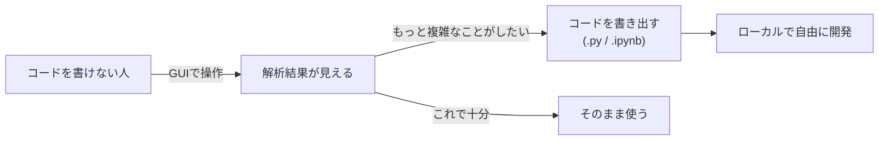

# プロダクトの目的と方針

このドキュメントは「なぜこれを作るのか」を定める。
「何を作るか(要求一覧)」は [requirements.md](requirements.md)、
「どう作っているか」は [design.md](design.md)、
「次に何をやるか」は [tasks.md](tasks.md) を参照。

判断に迷ったときは、このドキュメントに書かれた目的に照らして決める。

## 目的

**衛星データ解析を、コードを書けない人にも届ける。**

Google Earth Engine (GEE) は全球規模の衛星データと計算基盤を無償で公開している、
極めて強力なプラットフォームである。しかし現状、その力を引き出せるのは
プログラムを書ける人だけに限られている。

このアプリは、**GUI の操作だけで GEE の解析を完結できる**状態を目指す。

## 背景: 何が障壁になっているか

| 障壁 | 内容 |
| --- | --- |
| GEE Code Editor は JavaScript 必須 | 公式の GUI は実質的にコードエディタであり、JS が書けないと何もできない |
| Python API も同様 | `geemap` 等を使っても、結局コードを書く必要がある |
| 学習コストが二重 | 「リモートセンシングの知識」と「プログラミング」の両方を同時に要求される |
| 定型作業ほど割に合わない | NDVI を見る、雲を除く、期間で合成する — 頻出操作ほど毎回同じコードを書かされる |

問題の本質は、**ドメイン知識を持つ人とツールの間にプログラミングが挟まっている**ことにある。
農業・防災・環境・都市計画の現場には、衛星データで何を見たいかは分かっているが
コードは書かない、という人が多数いる。その層に届いていない。

## 目指す状態

1. **GUI だけで完結する。** 衛星を選び、見たいものを選び、解析を重ねる。
   この一連の操作でコードは一行も要らない。
2. **GEE でできることは GUI でも設定できる。** GEE API をトレースし、
   API が提供する操作を GUI の選択肢として対応付けていく。
   独自の便利機能を作り込むのではなく、GEE の表現力をそのまま GUI に写す。
3. **出口を塞がない。** GUI の範囲を超えた解析をしたくなったら、
   **その時点の設定をソースコード (.py / .ipynb) として書き出せる。**
   ユーザーはそれを自分のローカル環境に持ち帰り、続きを自由に開発できる。

3 が重要な点である。GUI ツールは往々にして「できることの天井」がユーザーの
上限になってしまう。ここでは GUI を**入口**と位置づけ、天井に達した人が
コードの世界へ地続きで移行できるようにする。GUI で試行錯誤して固めた設定が
そのまま動くコードになるので、白紙からコードを書き始めるより遥かに易しい。



## 基本方針

### 方針1: GEE API をトレースする

独自の抽象を発明せず、GEE API の構造に沿って GUI を作る。
ユーザーが GUI で覚えた概念が、そのままコードを書くときの概念になる
(=方針3 のコード書き出しと地続きになる)。

現在のドリルダウン構造は、この方針から導かれている。

```text
データセット      →  バンド合成・指数       →  解析              →  可視化
ee.ImageCollection   normalizedDifference     ee.Clusterer 等      Map.addLayer
```

### 方針2: 壊れた組み合わせを作らせない

コードなら実行してエラーで気づけるが、GUI ではエラーメッセージは敗北である。
各段が「何を要求し、何を出すか」を宣言し、**成立しない組み合わせは
選択肢として出さない**。

- Sentinel-1 (SAR) には赤・近赤外が無い → トゥルーカラーも NDVI も表示しない
- Canny エッジ検出は単バンド専用 → トゥルーカラーの直後には出さない
- DEM は時間軸を持たない → 期間の入力欄自体を消す

### 方針3: 出口を塞がない

GUI でできることには必ず天井がある。その天井をユーザーの上限にしない。
**いつでもその時点の設定をソースコードとして書き出せる**ようにし、
GUI からコードへ地続きで移行できるようにする。

このため、パイプラインの定義は実行可能なコードに変換できる形
(関数オブジェクトではなく、JSON 化できる純粋なデータ)で保持する。

### 方針4: 重い処理は GEE 側に置く

ピクセルを手元にダウンロードしない。`getMapId()` のタイルURLをブラウザに
渡すだけにすることで、非力な端末でも全球規模のデータをズーム・パンできる。
これは「手軽に使える」という目的の実現手段そのものであり、性能上の都合ではない。

## GEE API のトレース状況・次の優先度

「GEE でできることを GUI で」の進捗と、次に埋めるべきギャップは
[requirements.md](requirements.md) で要求一覧として管理する
(このアプリのロードマップを兼ねる)。

## 非目標

やらないことを明示しておく。

- **GEE の置き換えを目指さない。** 計算基盤は GEE のものを使う。
  ユーザーには GEE アカウントが必要である(将来サービスアカウント運用で
  隠蔽する可能性はあるが、GEE 依存自体は前提)。
- **GEE Code Editor の完全再現を目指さない。** API を GUI に写すが、
  写す順序は「使用頻度が高いもの」から決める。網羅性より実用性を優先する。
- **独自の解析アルゴリズムを作り込まない。** GEE が持つものを GUI から
  使えるようにするのが役割。GEE に無い解析が必要なら、コードを書き出して
  ローカルでやってもらう(それが方針3 の存在理由)。
- **ピクセルを手元に落とす解析を標準機能にしない。** 目的の「手軽さ」を損なう。
  必要になった時点でコード書き出しに委ねる(方針4)。

## この目的から導かれた設計判断

個々の設計判断とこの目的との対応は、実装の詳細とあわせて
[design.md の「設計判断まとめ」](design.md#設計判断まとめ目的との対応)に記録している。
